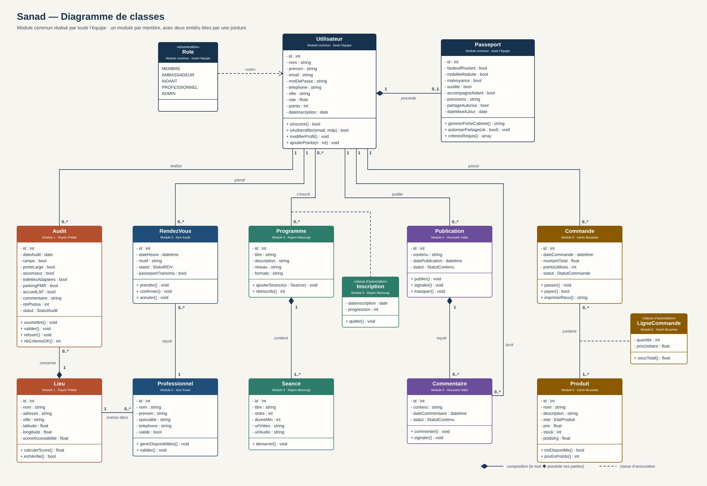

# Sanad – Plateforme de santé accessible

> **La santé accessible, vérifiée par ceux qui la vivent.**
> Projet développé à **Esprit School of Engineering – Tunisia** · Projet Technologies Web 2A · Année universitaire 2026–2027.

## Table des matières

- [Overview](#overview)
- [Features](#features)
- [Tech Stack](#tech-stack)
- [Architecture](#architecture)
- [Contributors](#contributors)
- [Academic Context](#academic-context)
- [Getting Started](#getting-started)
- [Utilisation](#utilisation)
- [Contribution](#contribution)
- [Acknowledgments](#acknowledgments)
- [Licence](#licence)

## Overview

This project was developed as part of the **Projet Technologies Web – 2nd Year Engineering Program** at **Esprit School of Engineering** (Academic Year 2026–2027).

**Sanad** (« soutien » en arabe) est une application web de santé et de bien-être inclusive.

**Le problème :** aujourd’hui, aucun site ne dit si un cabinet médical est vraiment accessible. Une personne en fauteuil, malvoyante ou sourde découvre souvent sur place que rien n’est prévu pour elle.

**Notre solution :**
- des **ambassadeurs**, des patients volontaires, vérifient sur place l’accessibilité des cabinets ;
- le **passeport d’accessibilité** du patient est transmis au cabinet avant chaque rendez-vous ;
- des **points solidaires** récompensent les audits et sont utilisables dans la boutique de matériel reconditionné.

Le projet contribue aux Objectifs de développement durable 3, 10, 11 et 12.

## Features

| Module | Responsable | Fonctionnalités | Jointure |
|---|---|---|---|
| Commun : comptes et passeport | Toute l’équipe | Inscription, connexion, passeport d’accessibilité, gestion des comptes | Utilisateur 1 — 0..1 Passeport |
| 1 · Audits d’accessibilité | Rayen Poletti | Audits sur place (6 critères + photos), score des lieux, validation | Lieu 1 — 0..* Audit |
| 2 · Professionnels et rendez-vous | Aziz Kouki | Recherche de lieux vérifiés, prise de RDV, validation des professionnels | Professionnel 1 — 0..* RendezVous |
| 3 · Programmes bien-être | Rayen Marzougi | Programmes et séances adaptés, inscriptions | Programme 1 — 1..* Séance |
| 4 · Communauté d’entraide | Houssem Hafsi | Publications, commentaires, signalement, modération | Publication 1 — 0..* Commentaire |
| 5 · Boutique solidaire | Karim Bousetta | Matériel reconditionné ou donné, commandes, paiement en points | Commande 0..* — 1..* Produit (LigneCommande) |

Chaque module a un **Front Office** (côté utilisateur) et un **Back Office** (tableau de bord administrateur).

## Tech Stack

### Frontend
- HTML5, CSS3, JavaScript
- **Front Office :** template [Medilab](https://bootstrapmade.com/medilab-free-medical-bootstrap-theme/) (Bootstrap 5)
- **Back Office :** template [TailAdmin](https://github.com/TailAdmin/tailadmin-free-tailwind-dashboard-template) (Tailwind CSS v4, Alpine.js, ApexCharts)

### Backend
- PHP 8 en architecture **MVC** (Models, Views, Controllers)
- MySQL (schéma dans `database/sanad.sql`)

## Architecture

```
Esprit-PW-2AXX-2026-Sanad/
├── frontoffice/                 # Partie client (atelier, partie 1)
│   ├── index.php                # point d’entrée : index.php?page=accueil
│   ├── Controllers/             # HomeController, AuditController, ...
│   ├── Models/
│   ├── Views/
│   │   ├── includes/            # head, spinner, navbar, footer, scripts
│   │   └── accueil.php, audits.php, professionnels.php, ...
│   └── assets/                  # css, img, js, vendor (Medilab)
├── backoffice/                  # Tableau de bord (atelier, partie 2)
│   ├── index.php                # point d’entrée : index.php?page=dashboard
│   ├── app/
│   │   ├── Controllers/         # Controller.php (render) + un contrôleur par entité
│   │   ├── Models/              # Model.php (PDO) + une classe par entité
│   │   ├── Views/
│   │   │   ├── assets/          # css, js, images
│   │   │   ├── partials/        # head, sidebar, header, footer, scripts
│   │   │   ├── pages/           # contenu de chaque page (HTML pur)
│   │   │   └── layout.php       # assemble les partials autour de $content
│   │   ├── helpers.php          # isActive(), groupOf(), ...
│   │   └── routes.php           # clé de page => [Controller, méthode]
│   ├── config/database.php
│   └── tailwind/input.css       # source CSS de TailAdmin (pour recompiler)
├── database/sanad.sql
└── docs/                        # diagrammes, tâches, guide GitHub
```



## Contributors

- Rayen Poletti
- Aziz Kouki
- Rayen Marzougi
- Houssem Hafsi
- Karim Bousetta

## Academic Context

Developed at **Esprit School of Engineering – Tunisia**
Projet Technologies Web – 2A | 2026–2027

## Getting Started

### Prérequis
- [XAMPP](https://www.apachefriends.org/) ou WAMP (PHP 8 et MySQL)
- Git
- Une connexion Internet (polices Google Fonts et Alpine.js sont chargées en ligne)

### Installation

1. Clonez le dépôt dans le dossier `htdocs` de XAMPP (ou `www` de WAMP) :
   ```bash
   git clone https://github.com/<organisation>/Esprit-PW-2AXX-2026-Sanad.git
   cd Esprit-PW-2AXX-2026-Sanad
   ```
2. Créez la base de données :
   * ouvrez phpMyAdmin (`http://localhost/phpmyadmin`) ;
   * importez le fichier `database/sanad.sql`.
3. Adaptez si besoin `backoffice/config/database.php` (utilisateur, mot de passe).
4. Lancez Apache et MySQL depuis XAMPP.

## Utilisation

- **Front Office :** `http://localhost/Esprit-PW-2AXX-2026-Sanad/frontoffice/index.php?page=accueil`
- **Back Office :** `http://localhost/Esprit-PW-2AXX-2026-Sanad/backoffice/index.php?page=dashboard`

Sans XAMPP, avec le serveur intégré de PHP :
```bash
cd backoffice
php -S localhost:8000
# puis ouvrez http://localhost:8000/index.php?page=dashboard
```

### Ajouter une page (Back Office)
1. Créez la vue `backoffice/app/Views/pages/ma_page.php` (HTML pur).
2. Ajoutez une méthode dans le contrôleur du module, qui définit `$this->page`, `$this->title` puis appelle `$this->render('ma_page')`.
3. Déclarez la route dans `backoffice/app/routes.php`.
4. Ajoutez le lien dans `backoffice/app/Views/partials/sidebar.php` : il devient actif automatiquement.

### Recompiler le CSS du Back Office
Le fichier `backoffice/app/Views/assets/css/style.css` est déjà compilé. Si vous ajoutez des classes Tailwind qui ne sont pas encore utilisées, recompilez avec le [Tailwind CSS CLI](https://tailwindcss.com/docs/installation/tailwind-cli) :
```bash
cd backoffice/tailwind
npx @tailwindcss/cli -i input.css -o ../app/Views/assets/css/style.css --minify
```

## Contribution

1. Créez une branche pour votre module :
   ```bash
   git checkout -b module-1-audits
   ```
2. Faites des commits clairs :
   ```bash
   git add .
   git commit -m "Module 1 : liste des audits dans le Back Office"
   ```
3. Poussez la branche et ouvrez une Pull Request vers `main` :
   ```bash
   git push origin module-1-audits
   ```
4. Mettez à jour l’état de vos tâches dans le tableau **Projects** du dépôt.

## Acknowledgments

- **Esprit School of Engineering** et les tuteurs du module Projet Technologies Web
- [TailAdmin](https://tailadmin.com) — template du Back Office (licence MIT)
- [Medilab par BootstrapMade](https://bootstrapmade.com/) — template du Front Office
- [ApexCharts](https://apexcharts.com/), [Alpine.js](https://alpinejs.dev/), [Tailwind CSS](https://tailwindcss.com/)

## Licence

Le code de ce projet est distribué sous licence **MIT** (voir le fichier `LICENSE`).
Les templates gardent leur propre licence : TailAdmin (MIT) et Medilab (licence gratuite BootstrapMade, qui impose de garder le lien de crédit dans le footer).
